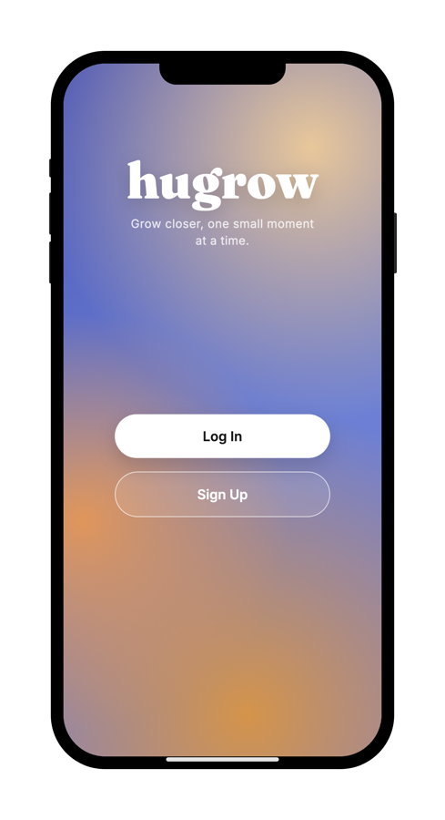
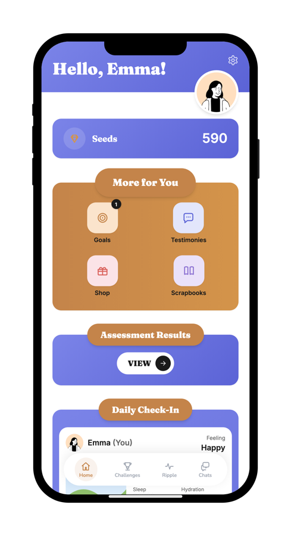
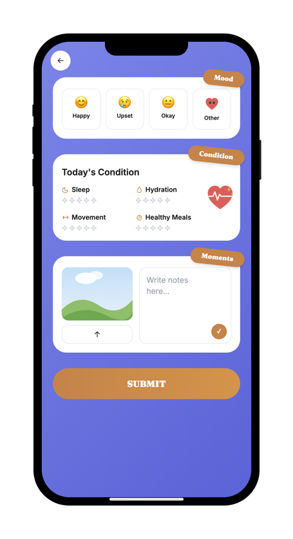
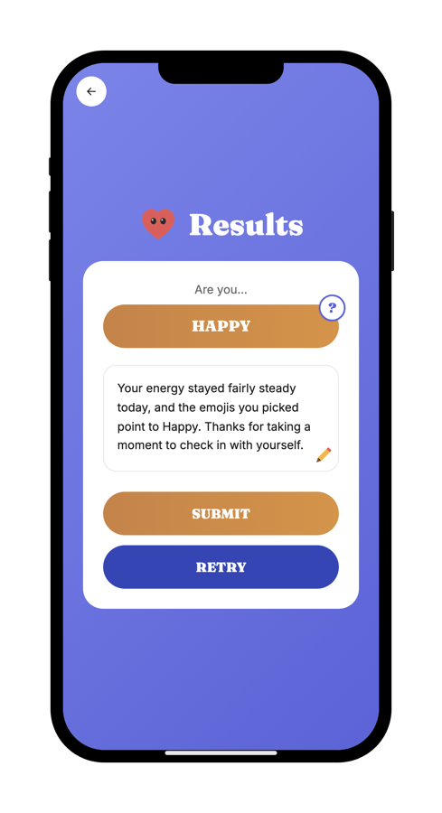
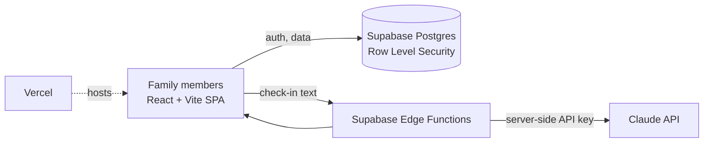
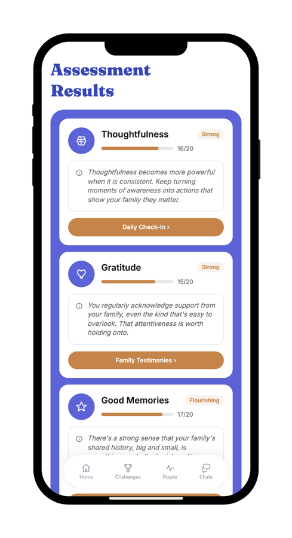
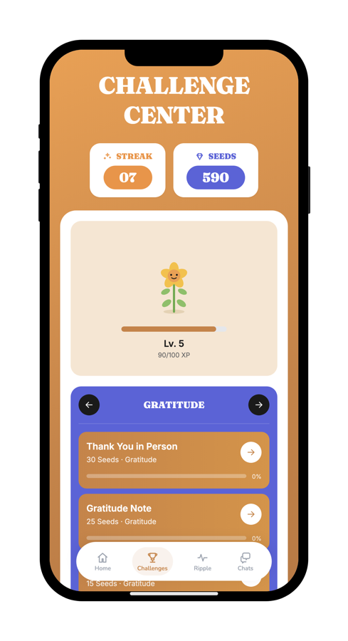
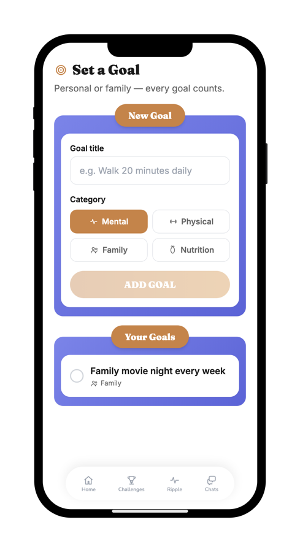
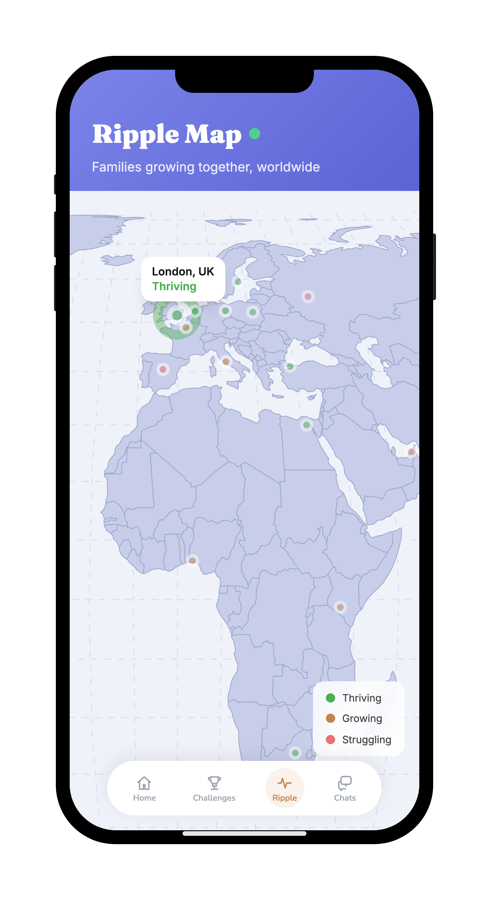

# Hugrow

**A family wellness app built around daily check-ins, shared goals, and small weekly challenges.**

1st Place and Ministry of Education Award, e-icon World Contest 2026 · Development Lead

> This repository shows the app's design and architecture. The contest source code is kept private.

  
  
  
  

## The idea

Families often share a home without sharing how each member is doing. Hugrow gives every member a short daily check-in, turns the results into a family view, and suggests challenges the family can do together. Completing check-ins and challenges earns Seeds that can be redeemed for vouchers from local businesses, and a Ripple Map shows where families using the app are growing.

## My role

**Development Lead.** I led the team's development of the app.

## How it works

- **Privacy by default.** Row Level Security lets each user read and write only their own rows. Members of the same household can see each other's profile and daily check-ins, which powers the shared family view.
- **AI kept on the server.** Mood analysis and assessment feedback call Claude through Supabase Edge Functions, so the API key never reaches the browser.
- **Works without AI.** If the Edge Functions are unavailable, check-ins and assessment results fall back to a local heuristic.

## Screens

  
  
  
  

## Stack

React · Vite · Tailwind CSS · Supabase (Postgres, Auth, Edge Functions) · Claude API · Vercel

All people and families shown are demo data.
